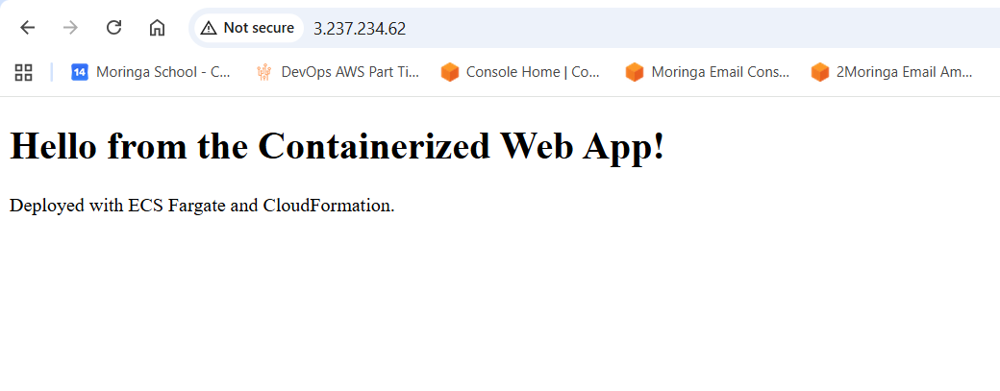
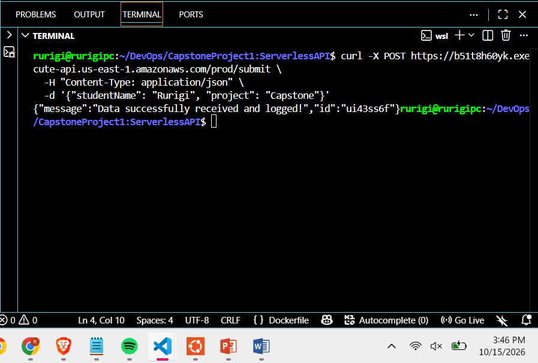
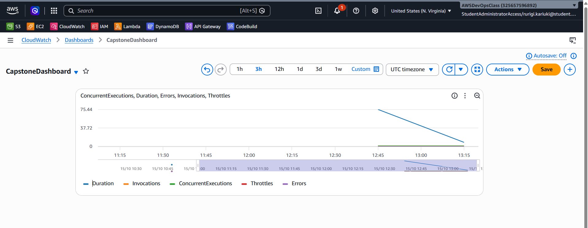

# Capstone Project 1: Serverless API & Containerized Web App

## Overview

A hybrid cloud-native application deployed on AWS, combining a containerized web app running on Amazon ECS (Fargate) with a serverless REST API built on AWS Lambda and API Gateway. The entire ECS infrastructure is provisioned via AWS CloudFormation (Infrastructure as Code), and observability is provided through Amazon CloudWatch.

## Architecture

- **Containerized Web App**: Nginx running on Amazon ECS Fargate, provisioned via CloudFormation
- **Serverless API**: AWS Lambda function triggered by Amazon API Gateway (POST /submit)
- **Observability**: CloudWatch Logs and a custom CloudWatch Dashboard tracking Lambda invocations and errors

## Live URLs

- **ECS Web Application**: http://3.237.234.62
- **API Endpoint**: https://b51t8h60yk.execute-api.us-east-1.amazonaws.com/prod/submit

## Screenshots

### 1. Live ECS Web Application Running in Browser


### 2. Successful API Gateway Test (curl)


### 3. CloudWatch Dashboard — Lambda Invocations & Errors



## AWS Services Used

| Service | Purpose |
|---|---|
| Amazon ECR | Stores the Docker image for the web app |
| Amazon ECS (Fargate) | Runs the containerized web application |
| AWS CloudFormation | Provisions ECS cluster, task definition, service, IAM role |
| AWS Lambda | Serverless backend that receives JSON payloads and logs them |
| Amazon API Gateway | Exposes the Lambda via a POST /submit REST endpoint |
| Amazon CloudWatch | Logs, metrics, and custom dashboard for observability |
| AWS IAM | Roles and permissions for ECS task execution and Lambda |

## Deployment Steps

### 1. Build & Push Docker Image to Amazon ECR

```bash
cd webapp
aws ecr get-login-password --region us-east-1 | docker login --username AWS --password-stdin 325657596892.dkr.ecr.us-east-1.amazonaws.com
docker build -t capstone-webapp .
docker tag capstone-webapp:latest 325657596892.dkr.ecr.us-east-1.amazonaws.com/capstone-webapp:latest
docker push 325657596892.dkr.ecr.us-east-1.amazonaws.com/capstone-webapp:latest